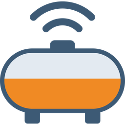

# Home Assistant Otodata BLE



Home Assistant integration for Otodata propane tank monitors. It reads the tank
level from the monitor's Bluetooth broadcasts.

Tested with a TM6030. Other Otodata monitors that broadcast the same packets
should work. Open an issue if yours doesn't.

Some monitors send a short device info packet with no model number and no
level packet. For these, the level is read from the monitor's name instead,
which needs a Bluetooth adapter or proxy that scans actively. That level is
rounded to whole percent and updates less often.

## Requirements

- Home Assistant 2026.6.4 or newer
- A Bluetooth adapter or an ESPHome Bluetooth proxy within range of the tank

## Installation

[](https://my.home-assistant.io/redirect/marketplace_repository/?owner=jterrace&repository=ha-otodata-ble&category=integration)

1. Click the button above, or search for Otodata BLE in HACS / Marketplace.
2. Download it and restart Home Assistant.

## Setup

Home Assistant finds the monitor on its own and shows it under Settings >
Devices & services as a discovered device. Click Add and confirm.

The monitor only broadcasts every few hours, so it can take a while to show
up. You can also add the integration by hand, which lists monitors Home
Assistant has already heard.

## Entities

| Entity          | Description                                                      |
| --------------- | ---------------------------------------------------------------- |
| Tank level      | Tank level in percent                                            |
| Fuel remaining  | Tank level times the tank capacity. Only if a capacity is set.   |
| Tank capacity   | The capacity you entered. Diagnostic, only if a capacity is set. |
| Signal strength | Bluetooth signal in dBm. Diagnostic, disabled by default.        |

The device's model and serial number fill in when the monitor sends its
device info packet, which can be some time after setup. Monitors with a short
info packet only fill in the serial number.

The level is for the tank the monitor is mounted on. If you have two tanks
plumbed together, only one is measured.

To get the fuel remaining sensor, open the integration's options and enter
the tank capacity in gallons or liters. Use the full size of the tank, not the
80% it's filled to. The level already counts from the full size. For tanks
plumbed together, enter the total.

The sensors go unavailable if the monitor stops broadcasting for longer than
usual. Until Home Assistant learns how often your monitor broadcasts, it
allows 6 hours.

## Debug logging

Add this to `configuration.yaml`:

```yaml
logger:
  logs:
    custom_components.otodata_ble: debug
```

Every Otodata packet is then logged with its raw bytes. Include these logs
when you open an issue.

## Protocol

The packet format is in [docs/tech-info.md](docs/tech-info.md).
